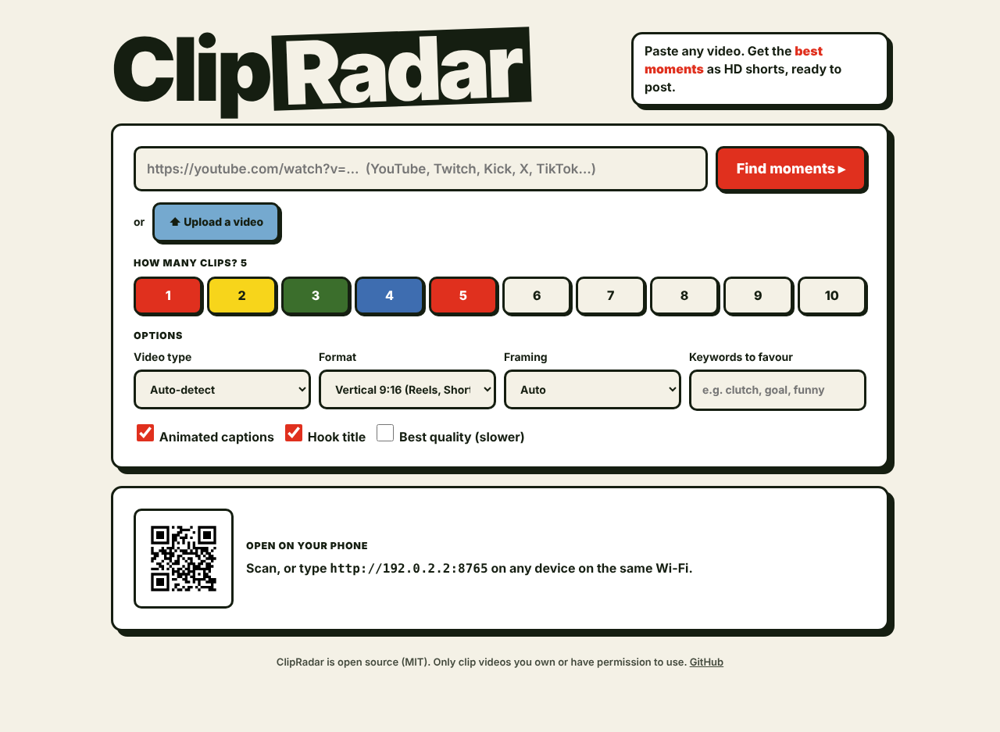
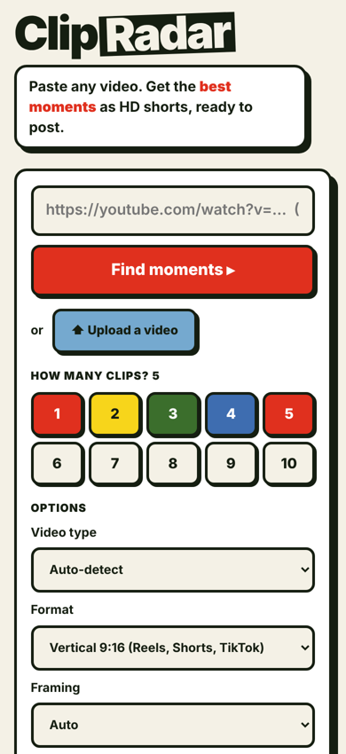
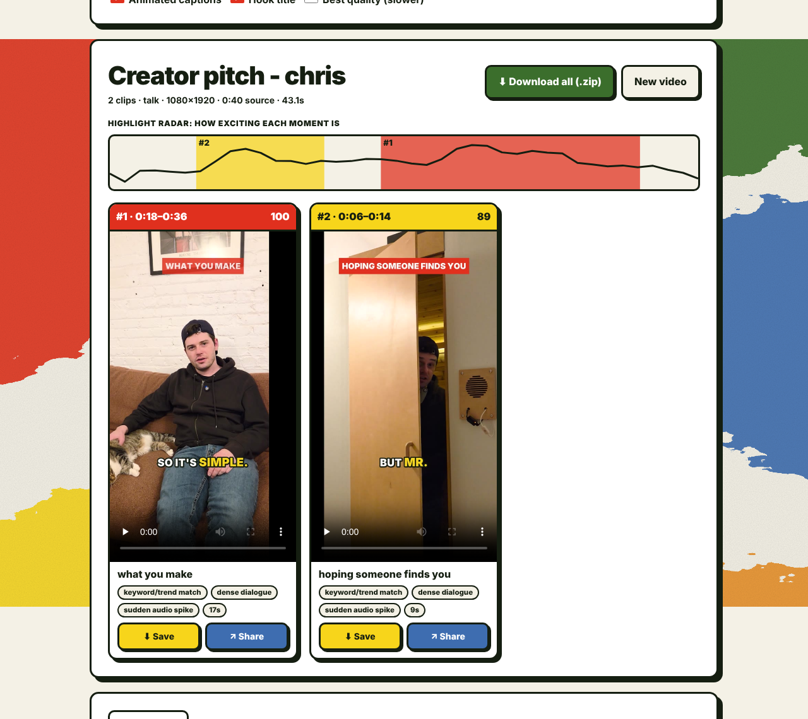

<p align="center"> </p>

# ClipRadar

**Paste any video link. Get its best moments as HD shorts, ready to post.**

ClipRadar watches, listens to and reads a video, scores every second, and cuts the top
1 to 10 moments into 1080x1920 clips with animated captions. It runs in your terminal, as a web app
you can open on any phone, tablet or computer, in Docker, or on Google Colab. **No API key needed.**

```bash
pip install "clipradar[asr] @ git+https://github.com/chirai-ultra/clipradar"
clipradar "https://www.youtube.com/watch?v=..." -n 5
```

## What makes it different

Most open-source clippers ask an LLM to read a transcript, which misses everything that isn't speech:
a clutch in a shooter, a goal, a crowd going wild. ClipRadar fuses **six independent signals** into one
"highlight radar" and explains why it picked each clip:

| Signal | What it catches | Where it comes from |
|---|---|---|
| **Audience trajectory** | moments viewers actually rewind | YouTube *Most Replayed* heatmap (via yt-dlp) |
| **Audio excitement** | spikes vs. the surrounding minute, impacts, cheers, gunfire | loudness, spectral flux, bass/treble energy (numpy) |
| **Motion & cuts** | fast action, chaotic scenes | low-res frame differencing + histogram scene cuts |
| **Speech keywords** | "no way!", "clutch", "goal", your own keywords | word-level transcript (faster-whisper or Parakeet) |
| **Topic + trends** | what the video is about and what people search right now | title, tags, chapters + live search suggestions |
| **LLM judgement** *(optional)* | hook, payoff, standalone context, titles | any OpenAI-compatible API, Gemini or local Ollama |

Weights adapt to the content type (gaming, talk, sports, auto-detected). Clip edges snap to scene cuts,
pauses and sentence ends so nothing starts mid-word, and the strongest second lands in the first third
of the clip, where the hook belongs.

Then every clip is rendered properly:
- **HD**: 1080x1920 (or 1:1 / 16:9), Lanczos scaling + light sharpening, H.264 high profile, faststart
- **Clean frame**: baked-in black bars are detected and removed first
- **Streamer layout**: finds the facecam (a small, steady face in a corner, its box measured from its static border), enlarges it on top and puts the gameplay below, automatically
- **Smart framing**: follows faces (OpenCV YuNet) or the action; *fit* mode keeps the whole game HUD over a blurred fill
- **Captions**: word-by-word highlight, plus a 3-second hook title; `.srt` exported too
- **Loudness**: normalised to -14 LUFS, the level TikTok, Reels and Shorts expect
- **Share**: download one clip, download all as ZIP, or tap Share on a phone to post straight to an app

## Use it

### Terminal
```bash
clipradar <url-or-file> -n 5                       # 5 clips, everything auto
clipradar match.mp4 -n 10 --content sports         # up to 10
clipradar <url> --content gaming --framing fit     # keep the full game screen
clipradar <twitch-vod> --framing stream            # facecam on top, gameplay below
clipradar <url> -k clutch -k "no way"              # favour moments with these words
clipradar <url> --layout landscape --min-len 30 --max-len 60
clipradar <url> --asr none                         # skip speech, still works
clipradar doctor                                   # check your setup
```
Output: `clipradar_output/<video>-<time>/clip01_<title>.mp4`, thumbnails, `.srt` captions and `clips.json`
(times, scores, reasons, transcript).

### Web app: any device


```bash
clipradar serve
```
Open `http://localhost:8765`. To use your **phone**, scan the QR code shown on the page (same Wi-Fi).
Add it to your home screen to install it like an app. On Android you can share a YouTube link straight into it.

### Docker (servers, NAS, cloud)
```bash
docker compose up -d        # then open http://<server>:8765
```

### Google Colab (no install, free GPU)
Open [`notebooks/ClipRadar_Colab.ipynb`](notebooks/ClipRadar_Colab.ipynb) in Colab.

### Python
```python
from clipradar import Options, run
res = run(Options(source="https://youtu.be/...", clips=3, content="gaming"))
print(res["clips"][0]["file"], res["clips"][0]["why"])
```

### AI agents (Claude Code and other skill-aware agents)
Copy [`skill/clipradar`](skill/clipradar) into your agent's skills folder. The agent can then clip videos for you on request.

## Options

| Flag | Default | |
|---|---|---|
| `-n, --clips` | 5 | 1 to 10 |
| `--content` | auto | `gaming`, `talk`, `sports` |
| `--layout` | vertical | `square`, `landscape`, `auto` (keep shape) |
| `--framing` | auto | `stream` (facecam on top + gameplay), `smart` (faces/action), `fit` (blurred background), `center` |
| `--min-len / --max-len` | preset | gaming 15-45 s, talk 25-60 s, sports 12-40 s |
| `-k, --keyword` | | repeatable |
| `--asr` | auto | `faster-whisper`, `sherpa` (fast English on CPU), `none` |
| `--asr-model` | small | faster-whisper size: tiny, base, small, medium, large-v3 |
| `--language` | auto | e.g. `en`, `hi`, `es` |
| `--no-captions`, `--no-hook-title`, `--no-trends`, `--no-llm` | | |
| `--quality` | fast | `best` = slower encode, sharper, smaller |
| `--cookies` | | cookies.txt for age/region-locked videos |

**Optional LLM re-rank** (better titles, judges hook and context):
```bash
export CLIPRADAR_LLM_BASE_URL=http://localhost:11434/v1   # Ollama, or https://api.openai.com/v1, OpenRouter, Groq, Gemini…
export CLIPRADAR_LLM_MODEL=llama3.1
export CLIPRADAR_LLM_API_KEY=                              # blank for local
```

## Requirements
Python 3.10+ and [ffmpeg](https://ffmpeg.org/download.html) on your PATH
(Windows: `winget install ffmpeg`, macOS: `brew install ffmpeg`, Linux: `apt install ffmpeg`).
Speech recognition is optional: `pip install "clipradar[asr]"` for faster-whisper, or `pip install sherpa-onnx`
for Parakeet (its model downloads automatically).

## Built on the shoulders of
ClipRadar was designed after studying the open-source clipping ecosystem. Ideas and lessons came from:
- [yt-dlp](https://github.com/yt-dlp/yt-dlp): downloads from 1,000+ sites and exposes YouTube's *Most Replayed* heatmap
- [FFmpeg](https://ffmpeg.org) and [libass](https://github.com/libass/libass): all cutting, reframing and caption rendering
- [faster-whisper](https://github.com/SYSTRAN/faster-whisper) and [sherpa-onnx](https://github.com/k2-fsa/sherpa-onnx) with NVIDIA Parakeet: word-level speech timing
- [OpenCV](https://opencv.org) and [OpenCV Zoo YuNet](https://github.com/opencv/opencv_zoo): face tracking for smart crops
- [mutonby/openshorts](https://github.com/mutonby/openshorts), [AI-Youtube-Shorts-Generator](https://github.com/Anil-matcha/AI-Youtube-Shorts-Generator),
  [opensource-clipping](https://github.com/NaufalRizqullah/opensource-clipping), [vinci-clips](https://github.com/tryvinci/vinci-clips),
  [clips-studio](https://github.com/ColinGPT9/clips-studio), [content-ai](https://github.com/buddah0/content-ai) and [clipforge](https://github.com/LakshmiSravyaVedantham/clipforge):
  LLM moment picking, vertical reframing, audio-first gameplay detection and per-scene energy scoring
- [PySceneDetect](https://github.com/Breakthrough/PySceneDetect): scene-cut approach
- [Inter](https://github.com/rsms/inter) typeface (SIL OFL) for captions

No code was copied from these projects; ClipRadar is an independent MIT implementation.

## Responsible use
Only clip videos you own or have permission to use, for example a creator's official clipping campaign.
Respect each platform's terms and the original creator's rights.

## Licence
MIT. See [LICENSE](LICENSE).
